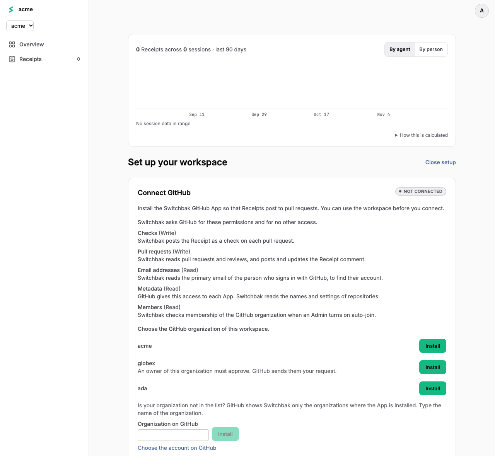
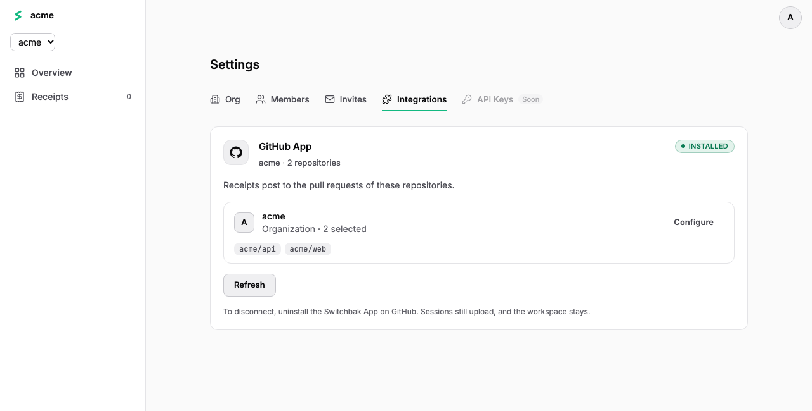

```bash
switchbak connect
```

Do this once for each GitHub organization or account whose pull requests get a Receipt. Pull requests get no Receipt until it is done. [Reading an Audit](../../guides/cli/audits.md) does not need it.

The type of your workspace decides what you can connect:

| Workspace | Connects                     |
| --------- | ---------------------------- |
| Personal  | Your own GitHub account only |
| Team      | GitHub organizations only    |

1. Connect opens Settings, Integrations on [app.switchbak.dev](https://app.switchbak.dev). Sign in if it asks
2. Press Connect GitHub. The Connect GitHub step lists your own account or your organizations
3. Press Install next to your own account for a Personal workspace, or next to your organization for a Team workspace. If the organization is not in the list, type its name in Organization on GitHub
4. On GitHub, select which repositories the GitHub App may read, and press Install & Authorize

GitHub sends your browser back to Switchbak, and the step says "GitHub is connected". Connect then prints `✓ GitHub connected`.

When your organization is already connected, connect prints the connected accounts and opens the same page. To add another organization to a Team workspace, press Connect another organization, then Install next to it.

A member sees "An Admin connects GitHub for this workspace." on the page. Ask an admin to run `switchbak connect`.

The wrong type of account connects nothing:

- A Personal workspace and an organization: the page says "That is a GitHub organization". Make a Team workspace for the organization at [app.switchbak.dev/signup](https://app.switchbak.dev/signup). Run `switchbak login` again, choose the Team workspace, and connect the organization there
- A Team workspace and your own account: the page says "That is a personal GitHub account". Install the App on your organization instead

The install stays on GitHub, and Switchbak offers it again to the workspace that can take it.

A member of a GitHub organization who is not an owner sees "Waiting for an owner to approve". GitHub sent the install to an owner. Ask an owner to approve it, and then run `switchbak connect` again.

## Connect from the web app

An admin can also connect GitHub on [app.switchbak.dev](https://app.switchbak.dev) without the CLI. Open the Overview, and in the Get started checklist press Install GitHub App. The Connect GitHub step is the same as in the steps above.



Settings, Integrations then shows the GitHub App as installed, with its repositories. Press Manage on GitHub to add a repository.



The Receipt check and the Receipt comment appear on the next push to a pull request in a chosen repository.

When the GitHub account is already connected to the Switchbak organization of your team, connect offers to join that organization.
