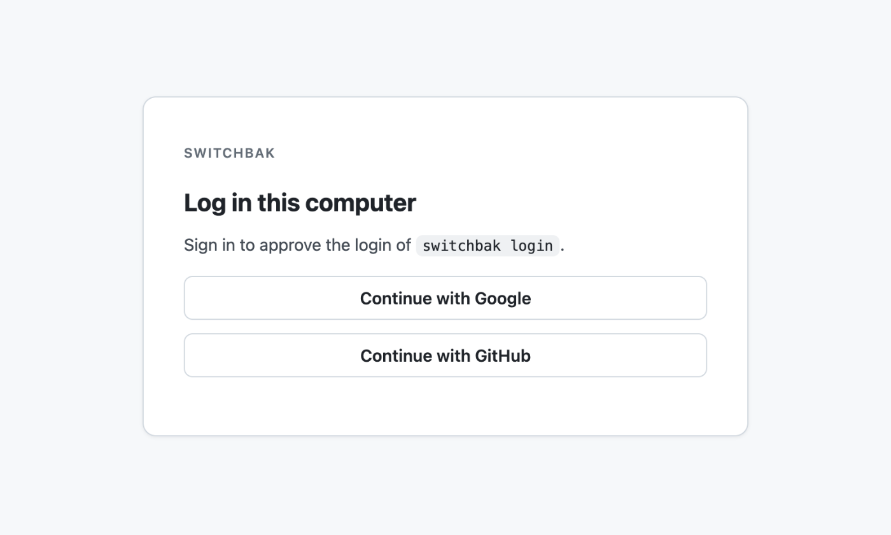
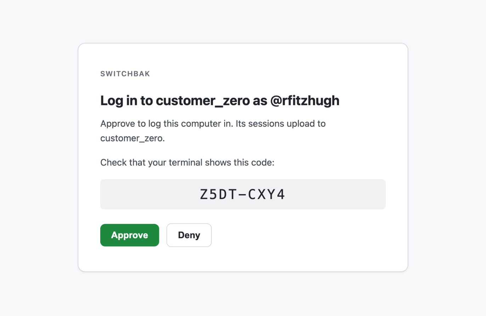
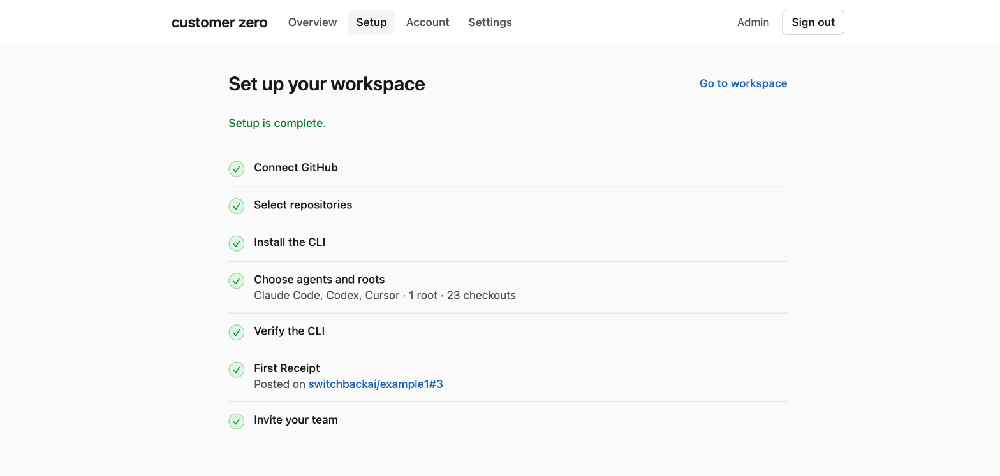
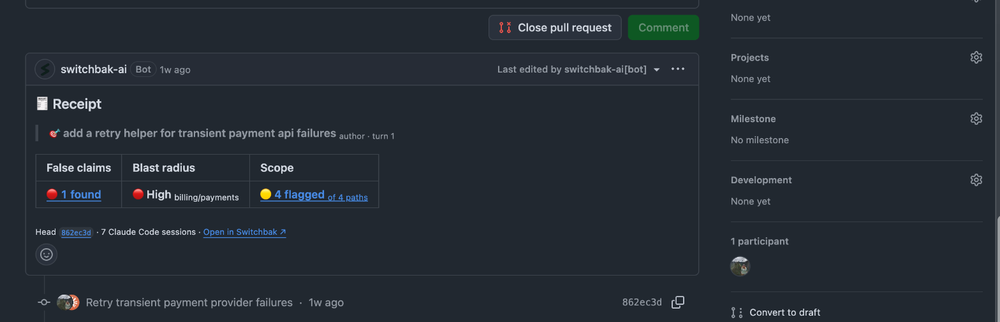
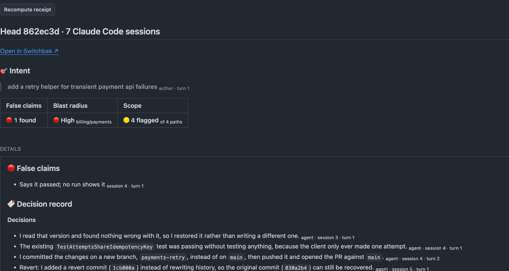
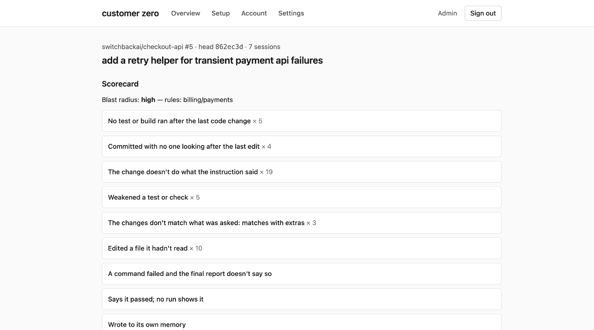

Install the client, log in, and connect GitHub. Then make a small change with your agent and open a pull request. The pull request gets a Receipt.

To see a Receipt before you start, open [switchbackai/docs#7](https://github.com/switchbackai/docs/pull/7). That repository uses Switchbak.

You need:

- A Mac with Apple silicon and [Homebrew](https://brew.sh)
- A GitHub account
- A [supported agent](../reference/supported-agents.md), for example Claude Code
- A repository on GitHub where you can push a branch and open a pull request. Use a repository of your own account: you install the GitHub App on it without the approval of an owner

## 1. Install the client

```bash
brew install switchbackai/tap/switchbak
```

See [Install](../set-up/install.md).

## 2. Log in

```bash
switchbak login
```

Login opens your browser. Choose Continue with GitHub, make sure that the page shows the code that login printed, and press Approve. To log in with Google, create your workspace at [app.switchbak.dev/signup](https://app.switchbak.dev/signup) first. See [Log in](../set-up/log-in.md).





Setup then watches each [installed agent](../set-up/agents-and-roots.md) and the directories that hold your checkouts. Keep your repository in one of them, for example `~/src` or `~/Documents/GitHub`.

## 3. Connect GitHub

```bash
switchbak connect
```

Connect opens GitHub. Select your account, select your repository, and press Install & Authorize. The page then says "Switchbak is connected". See [Connect GitHub](../set-up/connect-github.md).

Check the installation:

```bash
switchbak status
```

The first line is `ready     installed ✓  authenticated ✓  connected ✓`. The Setup page of [app.switchbak.dev](https://app.switchbak.dev) shows the same steps.



## 4. Make a change with your agent

1. Open your repository in a terminal, and make a branch:

   ```bash
   git switch -c try-switchbak
   ```

2. Start your agent in the repository, and give it a small task. For example:

   ```text
   Add a section "Run the tests" to README.md, with the command that runs the tests of this repository. Read the repository to find the command. Commit the change.
   ```

3. When the agent is done, push the branch and open a pull request, on GitHub or with `gh`:

   ```bash
   git push -u origin try-switchbak
   gh pr create --fill
   ```

## 5. Read the Receipt

The pull request first shows the check `🧾 Receipt` with "waiting for sessions", then "waiting for the session receipt". The Audit of the session starts when the session is idle for 5 minutes. Then the Receipt comment appears on the pull request:



The comment quotes the intent of the change. Its table shows the false claims, the blast radius and the scope. Open the check `🧾 Receipt` for the decision record and the scope diff:



Press "Open in Switchbak" for the full Receipt on app.switchbak.dev. Only a member of your workspace can open it.



See [The Receipt on a pull request](../use-switchbak/the-receipt.md).

## If there is no Receipt

| What you see                                         | What to do                                                                                                                                                                                                                                                                      |
| ---------------------------------------------------- | ------------------------------------------------------------------------------------------------------------------------------------------------------------------------------------------------------------------------------------------------------------------------------- |
| No `🧾 Receipt` check on the pull request            | The GitHub App cannot read the repository. Run `switchbak connect`, and select the repository on GitHub.                                                                                                                                                                        |
| "Waiting for an owner to approve"                    | The repository belongs to a GitHub organization, and GitHub sent the install to an owner. Ask an owner to approve it, then run `switchbak connect` again. Or use a repository of your own account.                                                                              |
| The comment says "No session bound for this change." | Switchbak has no session for this change. Run `switchbak status`. Make sure that the agent is selected and that the repository is below a watched directory, then make the change again with the agent, and push. See [Choose agents and roots](../set-up/agents-and-roots.md). |
| The Receipt does not assess the session              | The Audit failed. `switchbak status` names the reason under the `audit` line. See [Read an Audit](../use-switchbak/read-an-audit.md).                                                                                                                                           |
