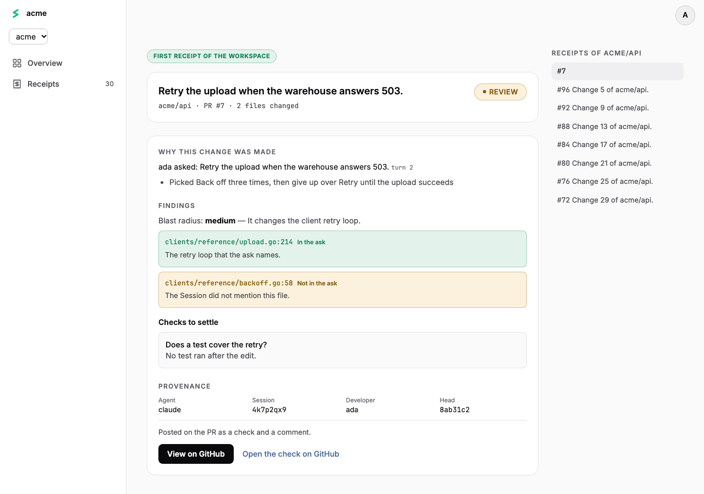

The Receipt is the distilled, cited record that holds the intent, constraints, decisions, redirects, negatives, open questions, and each changed path matched to its cited reason. Receipts are created per Changeset at one head, and it pulls together every Session that produced that change. Each stored Receipt never changes, instead a change (e.g., PR) gets a new one whenever its head or inputs change.

## How a Receipt is created

Here's how a Receipt is produced: 

1. The client on your laptop sends session streams to Switchbak. 
2. Each stream goes to the Audit Service. It returns a Verdict (pass / review / fail) and Findings (fix, ask, undecided, claim). This step is per Session, not per PR.
3. Switchbak links and attributes a Changeset to the Sessions that produced it; several sessions can feed one Changeset. 
4. The Receipt is built from the audits of the attributed sessions, persisted, then shown in the Switchbak UI and on the GitHub check. 

## Receipt on a GitHub PR
On each push to a pull request in a connected repository, the Switchbak App
writes a Receipt in two places: a check run named `🧾 Receipt`, and one comment
that it edits on each push. The comment is short:

> ##### 🧾 Receipt
>
>> **🎯 Add a small retry helper for transient payment API failures.** session
>
> | False claims | Blast radius                            | Scope                                     |
> | :----------- | :-------------------------------------- | :---------------------------------------- |
> | 🟢 **None**  | 🔴 **High** billing/payments | 🟢 **None flagged** of 3 paths |
>
> Head 8ab31c2 · 1 Claude Code session · Open in Switchbak ↗

The quote is the intent of the change, in the words of the session. The
citation after it says who stated it and in which turn.

The table has three columns:

- False claims: the claims that the session made and that its own tool results
  do not back. The session says that a check passed, and the run failed or
  did not run.
- Blast radius: low, medium or high, from rules on the changed paths, with the
  reason, for example `billing/payments` or `docs only`. The Audit can raise
  the level from what the session says. It does not lower it.
- Scope: the changed paths that the session does not explain.

A red or yellow count links to the check, which lists the detail.

### The check run

The check opens with the same intent and table, then these sections:

- 🔴 False claims: each claim, what the tool results show, and the turn.
- 🔖 Decision record: the decisions, each with the option that the session
  rejected, then the constraints, the human redirects and the open questions.
  Each item cites its turn. An item with no turn is not shown.
- ↔️ Scope diff: each changed path with a mark and the reason from the session.

### Scope marks

| Mark | Meaning                                                                                             |
| ---- | --------------------------------------------------------------------------------------------------- |
| 🟢   | The session asked for the change.                                                                   |
| 🧪   | A test of what the session asked for.                                                               |
| 🟡   | Flagged: the session did not mention it, or the session promised it and the diff does not touch it. |
| ⚪   | Flagged: the diff neither touches nor explains it.                                                  |

The check adds a "Why is this here?" note to each changed file. Its title
names the head commit that the Receipt describes and the sessions. "Open in
Switchbak" and the check's Details open the Receipt on `app.switchbak.dev`.
Only a member of your organization can open it. A person who is not signed in
signs in first and then sees the Receipt. A person who is not a member sees no
Receipt.

