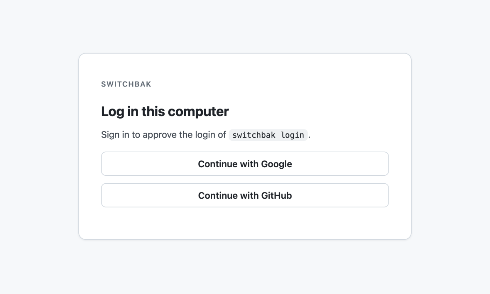

Get up and running in a couple of minutes. You'll need:

- A Mac with Apple silicon
- [Homebrew](https://brew.sh)
- A GitHub or Google account to sign in with
- A [supported agent](../guides/cli/set-up.md#supported-agents), like Claude Code

Rather have your coding agent do it? Press **Copy for your agent** and paste the prompt into your agent. You'll still approve the sign-in and the GitHub App yourself.

## 1. Install the CLI

```bash
brew install switchbackai/tap/switchbak
```

## 2. Log in

```bash
switchbak login
```

Your browser opens. Choose GitHub or Google, and check that the page shows the same code as your terminal.



## 3. Create your workspace

The first time you log in, the page says "Create your workspace". Choose:

- **Personal**, if it's just you
- **Team**, to work with others in your GitHub organization

Name the workspace and press **Create workspace**. When you're back in the terminal, setup picks your agents and checkout folders on its own and starts uploading your sessions.

:::note
Picked Team? See [Invite teammates](../admin/invite-teammates.md) to bring the rest of your team in.
:::

To see the account and the workspace that you logged in with, run:

```bash
switchbak whoami
```

It prints, for example:

```text
account   github octo
workspace octo (Personal)
```

## 4. Connect GitHub

Login asks `Connect GitHub now?` at the end. Press Return. You can also connect later from **Settings** > **Integrations** in the [web app](https://app.switchbak.dev), or from the terminal:

```bash
switchbak connect
```

Choose your GitHub organization for a Team workspace, or your own account for a Personal one. The page then says "GitHub is connected". If you're a member of a Team workspace, your admin does this step. See [Connect GitHub](../admin/integrations/github.md).

## 5. Check it's working

```bash
switchbak status
```

Look for `ready` on the first line. Then run your agent as usual and open a pull request. Its Receipt shows up on the pull request.

Want more detail on any step? See [Set up the CLI](../guides/cli/set-up.md).
