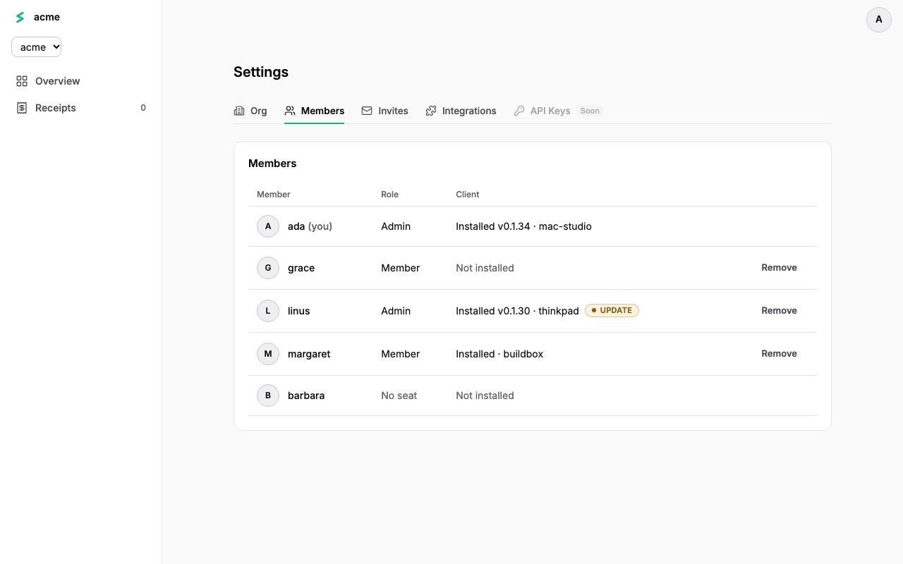
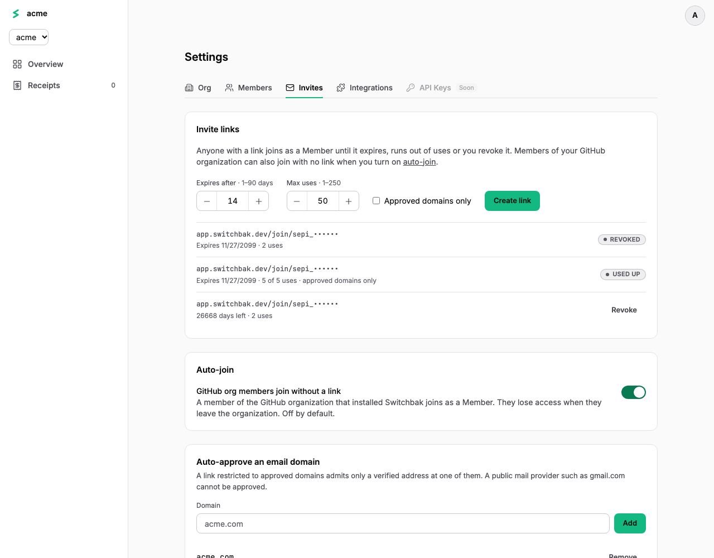

An admin of your organization sees its members and can remove a member. The person who made the organization is its admin. To make one, choose Team at your [first login](../set-up/log-in.md#your-first-login), or at [app.switchbak.dev/signup](https://app.switchbak.dev/signup). A Personal workspace has one member, you, and makes no invite links.

1. Sign in at [app.switchbak.dev](https://app.switchbak.dev)
2. Open the menu of your avatar, choose Settings, and open the Members tab. The tab shows the role and the client of each member
3. Press Remove next to a member, and confirm. Remove signs the member out at once

GitHub access does not add a removed member again. The login page of that person says "An admin removed you from <organization>".

## Invite a member

The Invites tab of Settings makes invite links. A person who opens a link joins as a member, until the link expires, runs out of uses or you revoke it.

- Invite links: set the days and the uses, and press Create link. Press Revoke to end a link
- Auto-join: a member of the GitHub organization that installed Switchbak joins with no link
- Auto-approve an email domain: a link set to Approved domains only admits only a verified email of that domain

